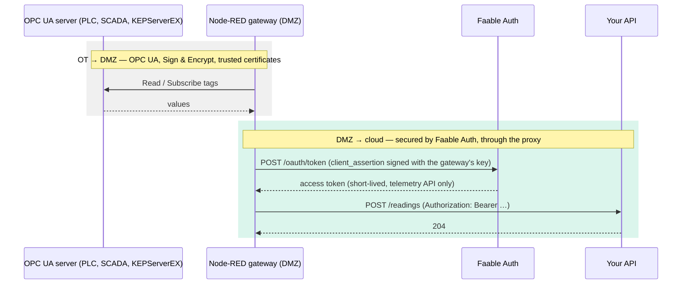

# Send OPC UA data to your API 🔌

**Short answer:** in a segmented plant, the PLCs stay in the OT zone behind an **OPC UA server** — the one built into the PLC, the SCADA, or an industrial server such as **KEPServerEX**. A **Node-RED gateway in the IT/OT DMZ** reads that server over OPC UA with **Sign & Encrypt** and its own trusted certificate, and sends the readings out to your API. **Faable Auth secures that last hop**: the gateway proves who it is with a private key that never leaves it ([`private_key_jwt`](../oauth-flows/client-credentials.mdx#private-key-jwt)), and every request carries a short-lived token that only opens your telemetry API.

Two links, two security mechanisms, each where it belongs:

- **OPC UA server → gateway** (OT → DMZ): OPC UA's own security — an encrypted, signed session between two certificates that trust each other, plus a user account on the server.
- **Gateway → your API** (DMZ → cloud): Faable Auth — a cryptographic identity per gateway, tokens that expire, and your API knowing which gateway sent each reading.

This guide covers the first link and the plant layout. The second is the same for every source of data and lives in the [PLC guide](./plc-node-red.mdx#step-2): this guide points to it rather than repeat it.

> [!TIP]
> A single machine, or a site without zones? Read the PLC directly from a gateway next to it — [Secure PLC telemetry](./plc-node-red.mdx) does that with a Siemens LOGO! 8.

---

## How it fits together



The firewall rules that follow from it:

| From → to           | What's allowed                                                                                                                 |
| ------------------- | ------------------------------------------------------------------------------------------------------------------------------ |
| OT zone → internet  | Nothing. The PLCs and the OPC UA server never reach the internet.                                                              |
| DMZ → OT zone       | The gateway to the OPC UA server's port only (`4840` by default on PLCs, `49320` on KEPServerEX).                              |
| DMZ → internet      | The gateway, port 443, to two hostnames — your tenant's domain and your API's host — usually through the DMZ's outbound proxy. |
| Internet → anything | Nothing. The gateway only makes outbound requests.                                                                             |

If your conduit rules only let the OT side open connections, run a concentrator in the OT zone that reads the OPC UA server and pushes the values to the gateway in the DMZ (MQTT is the usual choice); the Faable part stays on the gateway. [Where the gateway sits in a plant network](./plc-node-red.mdx#plant-network) explains the layout and the proxy settings.

---

## ✅ What you need

1. An **OPC UA server** with the tags you want to send, reachable from the gateway. Where it usually lives:

   | Source                       | OPC UA server                                                                                          |
   | ---------------------------- | ------------------------------------------------------------------------------------------------------ |
   | **Siemens** S7-1500          | Built into the CPU; activated in TIA Portal (needs the OPC UA runtime license)                         |
   | **B&R**                      | Built into Automation Runtime; activated in Automation Studio                                          |
   | **Beckhoff** TwinCAT         | TwinCAT OPC UA Server (TF6100)                                                                         |
   | **Omron** NX/NJ              | Built into the controller on most current models                                                       |
   | **Mitsubishi** MELSEC iQ-R   | OPC UA server module                                                                                   |
   | **Schneider Electric** M580  | OPC UA embedded server module                                                                          |
   | **Rockwell / Allen-Bradley** | Through a gateway such as FactoryTalk Linx Gateway                                                     |
   | Any brand, many PLCs         | An industrial OPC UA server (KEPServerEX and similar) that speaks each PLC's protocol, or your SCADA's |

   Which models and firmware versions include it varies; check your controller's documentation.

2. A **user account on the OPC UA server** for the gateway, with read access to those tags only. Don't use anonymous access.
3. A Faable Auth tenant with a **dedicated telemetry API** and **one M2M client per gateway**, as in [What you need](./plc-node-red.mdx#-what-you-need) in the PLC guide.
4. Node-RED 3 or later on the gateway, with [`node-red-contrib-opcua`](https://www.npmjs.com/package/node-red-contrib-opcua) from the palette.

---

## Step 1: Connect to the OPC UA server with Sign & Encrypt

Add an **OpcUa-Client** node and create its **endpoint** config:

- **Endpoint:** `opc.tcp://<server-host>:<port>` — for example `opc.tcp://kepserver.ot.example.local:49320` or `opc.tcp://10.10.1.20:4840`.
- **SecurityPolicy:** `Basic256Sha256` — or `Aes128_Sha256_RsaOaep` if your server offers it. Avoid `Basic128Rsa15` and `Basic256`: they are deprecated.
- **SecurityMode:** `Sign&Encrypt`. `Sign` alone protects the data from tampering but sends it in clear text.
- **User / Password:** the account from [What you need](#-what-you-need).

Turn off the `None` security policy on the server too. If the server still offers it, nothing forces a client to use the secure endpoint.

## Step 2: Trust the gateway's certificate on the server

With security on, both ends present a certificate. The node creates the gateway's own self-signed one on first start, under `~/.config/node-red-opcua-nodejs/PKI/own/certs/`. The first connection is **rejected** until the server trusts it — that's the point:

- **KEPServerEX:** open the **OPC UA Configuration Manager** → **Trusted Clients**, find the gateway's certificate (it appears as rejected after the first attempt) and trust it.
- **Siemens S7-1500:** in TIA Portal, under the CPU's **OPC UA → Server → Security**, add the gateway's certificate to the trusted clients and download the configuration. Leave _automatically accept client certificates during runtime_ off.
- **Other servers:** the setting is usually called _trusted clients_, _certificate store_ or _rejected certificates_.

Then deploy the flow again: the client node's status goes to _connected_.

> [!WARNING]
> `node-red-contrib-opcua` accepts the **server's** certificate automatically — the gateway doesn't check which server it's talking to. The server side does enforce trust, but keep the OT → DMZ link to the server's address and port only, so the gateway can't be pointed somewhere else.

## Step 3: Read the tags

Add one **OpcUa-Item** node per tag, with its **NodeId** and data type, all feeding the client node with action **READ**, triggered by an **inject** node every few seconds:

| Server             | Example NodeId                             |
| ------------------ | ------------------------------------------ |
| KEPServerEX        | `ns=2;s=Line1.Filler.Count`                |
| Siemens S7-1500    | `ns=3;s="DB_Telemetry"."Temperature"`      |
| Any (browse first) | use an **OpcUa-Browser** node to list them |

Each value comes out as its own message, with the NodeId in `msg.topic`. A **join** node in _manual_ mode — _key/value object_, key from `msg.topic`, after as many parts as tags you read — turns them into one object with every reading:

```
[inject: every 10 s] → [OpcUa-Item ×N] → [OpcUa-Client: READ] → [join] → [function: Faable token] …
```

For values that change rarely, action **SUBSCRIBE** sends only changes, at the interval you set; batch them before sending (a **join** with a timeout, or a **delay** in _rate limit_ mode), so your API doesn't get a request per change.

## Step 4: Send to your API with Faable Auth

From here on it's the same flow as reading a PLC directly. The object the join node outputs is the `msg.payload` the rest of the flow sends:

1. [Give the gateway a key](./plc-node-red.mdx#step-2) — the key pair that proves which gateway is sending, kept outside the flow.
2. [Get and cache the token](./plc-node-red.mdx#step-3-get-and-cache-the-token) — the two function nodes and two http request nodes.
3. [Accept only gateway tokens in your API](./plc-node-red.mdx#step-4-accept-only-gateway-tokens-in-your-api).
4. [Allow only your gateways](./plc-node-red.mdx#gateway-allow-list) with a `client-credentials` Action.

If the gateway goes out through the DMZ's proxy, set `HTTPS_PROXY` (and `NODE_EXTRA_CA_CERTS` if the proxy inspects TLS) as described in [What the firewall and the proxy need](./plc-node-red.mdx#what-the-firewall-and-the-proxy-need).

---

## ❓ FAQ

### OPC UA already has security. Why do I need Faable Auth?

They secure different links. OPC UA's security protects the session between the gateway and the OPC UA server, inside the plant. It ends at the gateway: your API, out in the cloud, never sees it. Faable Auth secures the link from the gateway to your API — it tells your API which gateway sent each reading, with a token that expires and only opens the telemetry API.

### Can't the OPC UA server send to my API directly?

Not without letting something in the OT zone reach the internet, which is what the zones are there to prevent. And an OPC UA server doesn't speak OAuth to your API. The gateway in the DMZ is the one component that talks to both sides.

### Sign or Sign & Encrypt?

Sign & Encrypt. `Sign` stops anyone from altering the values in transit, but anyone who can capture traffic on that segment can read them. The cost of encrypting a few tags every few seconds is negligible.

### Can one gateway read several OPC UA servers?

Yes: one endpoint config and one client node per server, all feeding the same flow. They share one Faable client and one key — the identity is the gateway's, not the server's. Add the source to the payload if your API needs to tell them apart.

### Where does the Faable key live in this layout?

On the gateway in the DMZ, and only there. The OPC UA server and the PLCs never hold a Faable key or a token. See [Give the gateway a key](./plc-node-red.mdx#step-2).

---

## 🔗 Related

- **[Secure PLC telemetry](./plc-node-red.mdx)** — the security layer in detail, reading a PLC directly, and Steps 2 to 5.
- **[Where the gateway sits in a plant network](./plc-node-red.mdx#plant-network)** — Purdue zones, the firewall and the proxy.
- **[Client Credentials (M2M)](../oauth-flows/client-credentials.mdx)** — the flow, `private_key_jwt` in detail, and every error.
- **[Validate Access Tokens](../validate-access-tokens.mdx)** — the API side.
