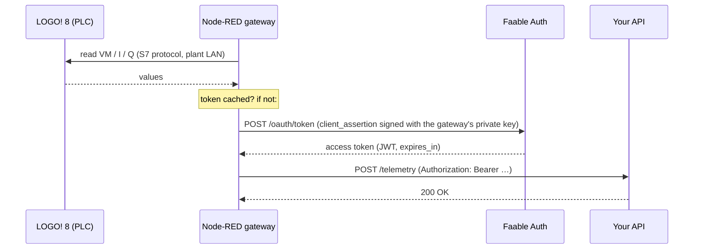

# PLCs and industrial gateways: M2M auth with Node-RED 🏭

**Short answer:** a PLC doesn't speak OAuth, and it shouldn't have to. Put a **Node-RED gateway** next to it: the gateway reads the PLC over the plant network (S7, Modbus, ADS, OPC UA…), gets an **M2M access token** from Faable Auth with the [Client Credentials flow](../oauth-flows/client-credentials.mdx), and calls your API over HTTPS with it. The gateway authenticates with [**`private_key_jwt`**](../oauth-flows/client-credentials.mdx#private-key-jwt) — a private key that never leaves the box — instead of a `client_secret` that anyone who copies the flow file can reuse.

This guide uses a **Siemens LOGO! 8**, the entry-level PLC, read with [`node-red-contrib-s7`](https://www.npmjs.com/package/node-red-contrib-s7). The auth part is the same for any PLC that Node-RED can read — see [Other PLCs](#other-plcs).

---

## How it fits together



- The **PLC** stays on the plant network and never talks to the internet.
- The **gateway** (a Raspberry Pi, an industrial PC, a Siemens IOT2050…) is the only thing that leaves it, over outbound HTTPS.
- **Faable Auth** knows each gateway as its own client, so you can see what each one does in the [logs](../logs.md) and cut one off without touching the others.
- **Your API** validates the token locally against your tenant's public keys — see [Validate Access Tokens](../validate-access-tokens.mdx).

---

## ✅ What you need

1. A Faable Auth tenant, and your API registered as an [API](../apis.md). Its `identifier` (e.g. `https://api.example.com`) is the `audience` the gateway asks for.
2. **One Machine-to-Machine client per gateway** ([Clients](../clients.md)). Restrict its grants to Client Credentials.
3. Node-RED 3 or later on the gateway, with these nodes from the palette: `node-red-contrib-s7`. The function node's **Setup → Modules** must be enabled (it is by default; if the tab is missing, set `functionExternalModules: true` in `settings.js`).
4. The gateway's clock synced with NTP — the client assertion carries an expiry, and a box that is minutes off gets refused.

---

## Step 1: Read the LOGO! from Node-RED

Install `node-red-contrib-s7` and add an **s7 endpoint** with the LOGO!'s IP address. On a LOGO! 8.FS4 the default **Rack 0 / Slot 2** works without TSAP settings; make sure S7 access is allowed in the module's access control settings (LOGO!Soft Comfort, online settings).

The LOGO! exposes its I/O and its variable memory (VM) as `DB1`:

| What               | LOGO! VM      | Node-RED address                  |
| ------------------ | ------------- | --------------------------------- |
| Digital inputs     | `1024 - 1031` | `DB1,X1024.0` … or `DB1,BYTE1024` |
| Analog input AI1   | `1032`        | `DB1,WORD1032`                    |
| Digital outputs    | `1064 - 1071` | `DB1,X1064.0` …                   |
| Your own variables | `0 - 849`     | `DB1,WORD2`, `DB1,DWORD4` …       |

The VM range `0 - 849` is what your LOGO! program maps with **Network** function blocks — that's where you put counters, temperatures or states you want to send. Add an **s7 in** node that reads the variables you need every few seconds; its `msg.payload` is the object the rest of the flow sends.

> [!TIP]
> Read on a timer, and send only on change or in batches. A LOGO! is happy to be polled every second, but your API doesn't need a request per second per gateway.

---

## Step 2: Give the gateway a key

On the gateway, generate a key pair. The private key stays here:

```bash
mkdir -p ~/.node-red/faable && cd ~/.node-red/faable
openssl genpkey -algorithm EC -pkeyopt ec_paramgen_curve:P-256 -out client-key.pem
chmod 600 client-key.pem
openssl pkey -in client-key.pem -pubout
```

In the [Faable Dashboard](https://dashboard.faable.com), open the gateway's client → **OAuth** → **Client authentication** → **Private key (private_key_jwt)**, paste the public key that last command printed, and save. Copy the key's **kid** shown in the list.

> [!WARNING]
> Keep the private key **out of the flow**. Node-RED exports flows to JSON that people email, commit and paste into forums — a key in a function node or a flow environment variable travels with it. A file only the Node-RED user can read, referenced by path, doesn't.

Give Node-RED the rest of the settings as **process environment variables** (in its systemd unit, or the container's env file):

```bash
FAABLE_AUTH_DOMAIN=https://your-domain.auth.faable.link
FAABLE_CLIENT_ID=your-client-id
FAABLE_KEY_ID=the-kid-from-the-dashboard
FAABLE_KEY_FILE=/home/pi/.node-red/faable/client-key.pem
FAABLE_AUDIENCE=https://api.example.com
API_URL=https://api.example.com/telemetry
```

---

## Step 3: Get and cache the token

Wire the flow like this:

```
[s7 in] → [function: Faable token] ─(1: has token)──────────────────────────────→ [http request: your API]
                                   └(2: needs token)→ [http request: token] → [function: store token] ─┘
```

**Function: Faable token** — two outputs. In its **Setup → Modules**, add `jose` (as `jose`), `crypto` (as `crypto`) and `fs` (as `fs`):

```js
// Output 1: the message, with a valid token in its Authorization header.
// Output 2: a token request for the http request node.
const cached = flow.get('faable_token')
if (cached && cached.expires_at > Date.now() + 60_000) {
  msg.url = env.get('API_URL')
  msg.method = 'POST'
  msg.headers = { authorization: `Bearer ${cached.access_token}` }
  return [msg, null]
}

const AUTH = env.get('FAABLE_AUTH_DOMAIN')
const CLIENT_ID = env.get('FAABLE_CLIENT_ID')

// The client assertion: a 60-second JWT signed with the gateway's key.
const key = await jose.importPKCS8(
  fs.readFileSync(env.get('FAABLE_KEY_FILE'), 'utf8'),
  'ES256'
)
const assertion = await new jose.SignJWT({})
  .setProtectedHeader({ alg: 'ES256', kid: env.get('FAABLE_KEY_ID') })
  .setIssuer(CLIENT_ID)
  .setSubject(CLIENT_ID)
  .setAudience(`${AUTH}/oauth/token`)
  .setIssuedAt()
  .setExpirationTime('60s')
  .setJti(crypto.randomUUID())
  .sign(key)

// Keep the PLC data to send it once the token arrives.
msg.plc = msg.payload
msg.url = `${AUTH}/oauth/token`
msg.method = 'POST'
msg.headers = { 'content-type': 'application/x-www-form-urlencoded' }
msg.payload = new URLSearchParams({
  grant_type: 'client_credentials',
  client_id: CLIENT_ID,
  client_assertion_type:
    'urn:ietf:params:oauth:client-assertion-type:jwt-bearer',
  client_assertion: assertion,
  audience: env.get('FAABLE_AUDIENCE')
}).toString()
return [null, msg]
```

**http request: token** — Method: _set by msg.method_, URL: empty (taken from `msg.url`), Return: _a parsed JSON object_.

**Function: store token**:

```js
if (msg.statusCode !== 200) {
  // error_description says what to fix: an expired assertion is the clock,
  // a signature error is the key or the kid.
  node.error(`Faable token request failed: ${JSON.stringify(msg.payload)}`, msg)
  return null
}
flow.set('faable_token', {
  access_token: msg.payload.access_token,
  expires_at: Date.now() + msg.payload.expires_in * 1000
})
msg.url = env.get('API_URL')
msg.method = 'POST'
msg.headers = { authorization: `Bearer ${msg.payload.access_token}` }
msg.payload = msg.plc
delete msg.plc
return msg
```

**http request: your API** — Method: _set by msg.method_, Return: _a parsed JSON object_. Both function nodes feed it.

That's the whole integration: the first message signs an assertion and gets a token; the next ones reuse it until a minute before it expires.

> [!NOTE]
> Two messages that arrive while there's no token yet each request one — harmless, the second just replaces the first. If your PLC is read many times a second, put a **delay** node in _rate limit_ mode before the token function.

---

<a id="token-usage"></a>

## 💶 How many tokens a gateway uses

Each token request counts as one [M2M token](../pricing.mdx#machine-to-machine-tokens). Every plan includes 100 a month per project; on Free that's a cap, on Hobby and Pro the rest are billed per thousand.

With the token cached, a gateway requests one per **token lifetime**, which is the API's `token_lifetime` setting:

| API `token_lifetime` | Tokens per gateway per month | Gateways within 100 |
| -------------------- | ---------------------------- | ------------------- |
| 1 hour               | ~720                         | 0                   |
| 24 hours (default)   | ~30                          | 3                   |
| 7 days               | ~5                           | 20                  |

A longer lifetime means fewer tokens, and also a longer window if a token leaks — access tokens can't be revoked before they expire. For gateways on your own network, 24 hours to 7 days is a reasonable range. A Node-RED restart empties the flow context, so it costs one more token; set `contextStorage` to `localfilesystem` in `settings.js` if your gateways restart often.

---

<a id="other-plcs"></a>

## Other PLCs

Faable Auth doesn't care what's behind the gateway: Steps 2 and 3 are identical for every brand. What changes is the node that reads the PLC in Step 1:

| Manufacturer                    | Typical protocol   | Node-RED node                                                                                                                                                        |
| ------------------------------- | ------------------ | -------------------------------------------------------------------------------------------------------------------------------------------------------------------- |
| **Siemens** S7-1200/1500, LOGO! | S7 (ISO-on-TCP)    | [`node-red-contrib-s7`](https://www.npmjs.com/package/node-red-contrib-s7)                                                                                           |
| **Beckhoff** TwinCAT            | ADS                | [`node-red-contrib-ads-client`](https://www.npmjs.com/package/node-red-contrib-ads-client)                                                                           |
| **Yaskawa** iC9200, MP3300iec   | OPC UA, Modbus TCP | [`node-red-contrib-opcua`](https://www.npmjs.com/package/node-red-contrib-opcua), [`node-red-contrib-modbus`](https://www.npmjs.com/package/node-red-contrib-modbus) |
| **Rockwell / Allen-Bradley**    | EtherNet/IP (CIP)  | [`node-red-contrib-cip-ethernet-ip`](https://www.npmjs.com/package/node-red-contrib-cip-ethernet-ip)                                                                 |
| **Schneider Electric** Modicon  | Modbus TCP         | [`node-red-contrib-modbus`](https://www.npmjs.com/package/node-red-contrib-modbus)                                                                                   |
| **Mitsubishi** MELSEC           | MC protocol (SLMP) | [`node-red-contrib-mcprotocol`](https://www.npmjs.com/package/node-red-contrib-mcprotocol)                                                                           |
| **Omron** CJ/CP/NX              | FINS               | [`node-red-contrib-omron-fins`](https://www.npmjs.com/package/node-red-contrib-omron-fins)                                                                           |
| Any controller with OPC UA      | OPC UA             | [`node-red-contrib-opcua`](https://www.npmjs.com/package/node-red-contrib-opcua)                                                                                     |

A few notes:

- **Beckhoff:** ADS needs a route on the TwinCAT side for the gateway's AMS Net ID before the node can connect.
- **WAGO** and **Phoenix Contact PLCnext** controllers can run Node-RED on the controller itself, so there's no separate gateway — the key pair then lives on the PLC.
- **Siemens IOT2050** is an industrial gateway that runs Node-RED, a natural fit for an S7 line.
- **OPC UA** is the safest default for a new installation: most current controllers expose it, and one node covers all of them.

---

## ❓ FAQ

### Can the PLC call Faable Auth directly?

Usually not, and it shouldn't: an entry-level PLC like the LOGO! can't sign a JWT or hold a TLS session to the internet, and putting a PLC on the internet widens its attack surface. A gateway on the plant network does the HTTPS and the auth; the PLC only talks to the gateway.

### Why private_key_jwt instead of a client secret?

Because gateways get copied: the flow is exported, the SD card is cloned, the project is emailed to the integrator. A `client_secret` travels with all of those and keeps working until you rotate it. With `private_key_jwt` the device holds a private key that only signs short-lived, single-use assertions, and Faable Auth stores only the public half. See [Authenticate with a private key](../oauth-flows/client-credentials.mdx#private-key-jwt).

### Should several gateways share one client?

No — one client per gateway. Each gets its own key and its own lines in the [logs](../logs.md), and you can cut one gateway off — delete its client — without touching the rest.

### What happens if a gateway is stolen?

Delete its client in the dashboard: the next token request fails, and nothing else is affected because the client was only that gateway's. Tokens it already holds stay valid until they expire, which is why the [token lifetime](#token-usage) matters.

### The token request fails with `client_assertion_expired`. Why?

The gateway's clock is off. The assertion's `exp` is checked with 60 seconds of tolerance; sync the gateway with NTP. The full list of errors is in [Client Credentials → Common errors](../oauth-flows/client-credentials.mdx).

---

## 🔗 Related

- **[Client Credentials (M2M)](../oauth-flows/client-credentials.mdx)** — the flow, `private_key_jwt` in detail, and every error.
- **[Validate Access Tokens](../validate-access-tokens.mdx)** — the API side.
- **[APIs](../apis.md)** — audience, permissions and `token_lifetime`.
- **[Auth pricing](../pricing.mdx#machine-to-machine-tokens)** — what M2M tokens cost.
