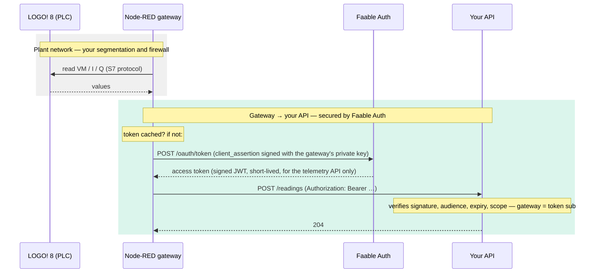
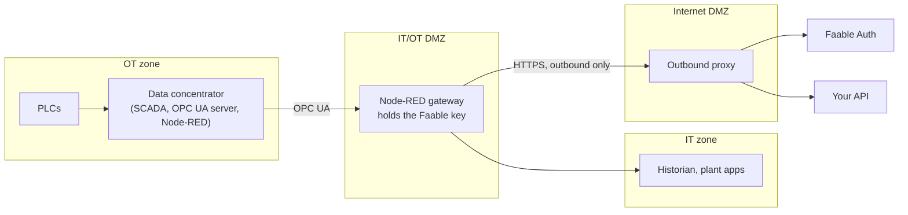

# Secure PLC telemetry: the path from your gateway to your API 🏭

**Short answer:** PLC data is only as trustworthy as the path that carries it **from the gateway to your API**. That's the hop that leaves the plant, crosses networks you don't control, and lands in the system where you store readings, trigger alarms and bill customers — and it's the hop **Faable Auth secures**. The PLC stays on the plant network; a **Node-RED gateway** next to it reads it (S7, Modbus, ADS, OPC UA…) and sends the data to your API. Faable Auth makes every one of those requests answer three questions before your API accepts it:

- **Who is sending this?** A specific gateway, proven with a private key that never leaves it ([`private_key_jwt`](../oauth-flows/client-credentials.mdx#private-key-jwt)) — not a shared password that anyone who copies the flow can reuse.
- **Is it allowed to?** It carries a short-lived [M2M access token](../oauth-flows/client-credentials.mdx) that only opens your telemetry API, and only for writing readings.
- **Can it be replayed or forged?** No: what travels expires within minutes, can't be reused, and is signed — your API verifies it with public keys and stores, with every reading, which gateway sent it.

Without that layer, a gateway posting to a URL — or with a static API key pasted into its config — gives your API no way to tell your gateways from anyone who found the URL or the key. [The path Faable Auth secures](#security-layer) explains each layer and what it stops.

This guide uses a **Siemens LOGO! 8**, the entry-level PLC, read with [`node-red-contrib-s7`](https://www.npmjs.com/package/node-red-contrib-s7). The auth part is the same for any PLC that Node-RED can read — see [Other PLCs](#other-plcs).

---

## How it fits together



Two hops, two different jobs:

- **PLC → gateway** happens inside the plant, over the PLC's own protocol. It's protected the way plant networks are: segmentation, a firewall, and the PLC never reachable from outside. Faable Auth doesn't take part in it.
- **Gateway → your API** is the one that leaves the plant, and the one **Faable Auth secures**: every request carries a token that proves which gateway sent it, expires, and only opens the telemetry API. The gateway (a Raspberry Pi, an industrial PC, a Siemens IOT2050…) only makes **outbound** HTTPS requests — no inbound port, no VPN into the plant.

That's the simplest layout: one gateway next to the PLC with a way out. Most production plants put more zones in between — see [Where the gateway sits in a plant network](#plant-network).

---

<a id="plant-network"></a>

## 🏗️ Where the gateway sits in a plant network

To meet industrial cybersecurity requirements (IEC 62443, NIS2), a plant rarely lets anything on the control network talk to the internet. The usual layout follows the [Purdue model](https://en.wikipedia.org/wiki/Purdue_Enterprise_Reference_Architecture): the PLCs and a **data concentrator** (SCADA, an OPC UA server, KEPServerEX, a Node-RED instance…) sit in the OT zone; an **IT/OT DMZ** separates them from the plant's IT, where historians and plant apps run (AVEVA PI, inmation…); and a second DMZ separates IT from the cloud. No zone talks to one that isn't next to it.



Faable Auth doesn't change any of that. The rule is simple: **the key pair lives on the component that makes the last hop to the cloud** — the gateway in the DMZ or IT zone, never a box in the OT zone. Nothing in the OT zone needs internet access, a Faable key or a token; it only needs to be readable from the zone next to it, the way it already is.

How the gateway gets the data depends on what the plant already has:

- **A small site or a single machine:** one Node-RED gateway reads the PLC directly (Step 1) and goes out through the plant firewall. That's the layout in the rest of this guide.
- **A concentrator in the OT zone** — SCADA, the PLC's own OPC UA server or an industrial OPC UA server such as KEPServerEX: the gateway in the DMZ reads it over OPC UA, with Sign & Encrypt and the gateway's certificate trusted on the server. See [Send OPC UA data to your API](./opcua-node-red.mdx).
- **The readings already reach a historian in the IT zone:** the gateway can read them from there instead of from the OT zone.

In every case Steps 2 to 5 are the same: the gateway holds the key, gets the token and sends to your API.

### What the firewall and the proxy need

- **Outbound only, port 443, to two hostnames:** your tenant's domain (`your-domain.auth.faable.link`, or your custom domain) for the token, and your API's host for the readings. Nothing inbound to the gateway, and no VPN. The gateway never fetches the public keys (JWKS) — your API does.
- **Allow by hostname, not by IP.** Faable Auth's addresses aren't guaranteed to stay fixed; FQDN rules on the proxy or firewall are what to use.
- **Through the DMZ proxy:** Node-RED's **http request** node uses the proxy in the `HTTPS_PROXY` environment variable (and skips the hosts in `NO_PROXY`). Set them next to the other variables in [Step 2](#step-2), or pick a proxy config — with credentials, if the proxy asks for them — under **Use proxy** in both http request nodes:

  ```bash
  HTTPS_PROXY=http://proxy.dmz.example.local:3128
  NO_PROXY=localhost,127.0.0.1,.plant.example.local
  ```

- **A proxy that inspects TLS** re-signs every connection with its own CA. Give Node.js that CA with `NODE_EXTRA_CA_CERTS=/path/to/proxy-ca.pem`, or every request fails with a certificate error. What such a proxy can see on the wire is covered by the security layer: the client assertion is single-use and already spent, and the access token expires and only opens the telemetry API.

---

<a id="security-layer"></a>

## 🛡️ The path Faable Auth secures: gateway → your API

Everything your API does with PLC data — storing it, alarming on it, billing for it, showing it to a customer — trusts that the data came from **your** gateway and arrived **unaltered**. That trust is decided on the path between the gateway and the API, and that's where it usually breaks: a gateway that posts to an open endpoint, or a static API key pasted into every gateway's config. Either way your API can't tell a real gateway from anyone who found the URL or the key, and a leaked key works from anywhere, forever.

Faable Auth puts standard OAuth 2.0 on that path. These are the layers it adds:

### 1. A cryptographic identity per gateway

Each gateway is its own client with its own key pair. The **private key is generated on the gateway and never leaves it**; Faable Auth stores only the public half. There is no shared secret to copy out of a flow export, a backup or the integrator's email — and a public key that leaks is harmless by definition.

### 2. Nothing reusable on the wire

What the gateway sends to Faable Auth is a **client assertion**: a JWT valid for 60 seconds, **single-use** (its `jti` is recorded and a second use is refused), and bound to your tenant's token endpoint (`aud`), so it can't be replayed against another server either. What it gets back — the **access token** — is a signed JWT that expires (you choose how soon, see [token usage](#token-usage)) and is bound to **one API** by its `aud` claim: a telemetry token is refused by every other API you run.

### 3. Least privilege

Register a **dedicated API for telemetry** (e.g. `https://telemetry.example.com`) with a single permission, `write:telemetry`, and `enforce_policies` on. A gateway token then grants exactly that: it can't read your customers' data or call your admin endpoints, even if it leaks — those live behind other audiences. With a [`client-credentials` Action](#gateway-allow-list) you also decide **which clients may get a telemetry token at all**, so a client created for something else in the same tenant can't post readings.

### 4. Signed attribution of every reading

The access token's `sub` is the gateway's `client_id`, signed by Faable Auth. Your API takes the gateway's identity **from the token, never from the payload** — so gateway A can't post readings as gateway B, and every row you store says, verifiably, where it came from. An Action can add the plant or line to the token as a claim, so the API doesn't even need a lookup table.

### 5. Your API holds no secrets

The API validates each token **locally**, against your tenant's public keys (JWKS). Nothing secret lives on the API side, and validating doesn't call Faable Auth on every request — the telemetry path keeps working at full speed.

### 6. Visibility and containment

The tenant's [logs](../logs.md) record every token issued and **every failed attempt**, per client, with the source IP and the reason (`client_assertion_signature_invalid`, `client_assertion_replayed`, `client_assertion_expired`…). A replayed assertion or a bad signature on a gateway's client is an alarm, not noise. Token requests are rate-limited per client. And cutting one gateway off is one action — delete its client — with no effect on the others.

### What each layer stops

| Threat                                                                    | What stops it                                                                                                                                                                                                                               |
| ------------------------------------------------------------------------- | ------------------------------------------------------------------------------------------------------------------------------------------------------------------------------------------------------------------------------------------- |
| Someone finds your API's URL and posts fake readings                      | No valid token, no write: the API answers `401`.                                                                                                                                                                                            |
| A flow export, backup or support ticket leaks the gateway's configuration | It contains no secret: the private key is a file outside the flow, and the client has no usable `client_secret`.                                                                                                                            |
| A request is captured on the plant network or in a proxy's logs           | The assertion has already been used and expires within a minute; the access token expires and only opens the telemetry API.                                                                                                                 |
| A stolen access token is used against your other APIs                     | Its `aud` is the telemetry API: every other API refuses it.                                                                                                                                                                                 |
| One gateway tries to post as another                                      | The API reads the gateway from the signed `sub`, not from the payload.                                                                                                                                                                      |
| Another client in the same tenant asks for a telemetry token              | The [allow-list Action](#gateway-allow-list) denies it.                                                                                                                                                                                     |
| A gateway is stolen or compromised                                        | Delete its client: no new tokens from that moment; the one it holds expires on its own. The logs show what it did.                                                                                                                          |
| The gateway's disk is cloned, key file included                           | This is the one layer software can't close — a copied private key is a copy of the identity. It shows up in the logs (one client, two source IPs); delete the client and issue a new key. Restrict who can read the key file (`chmod 600`). |

---

## ✅ What you need

1. A Faable Auth tenant, and a **dedicated telemetry API** registered as an [API](../apis.md), with one permission, `write:telemetry`, and `enforce_policies` on. Its `identifier` (e.g. `https://telemetry.example.com`) is the `audience` the gateway asks for.
2. **One Machine-to-Machine client per gateway** ([Clients](../clients.md)). Restrict its grants to Client Credentials.
3. Node-RED 3 or later on the gateway, with these nodes from the palette: `node-red-contrib-s7`. The function node's **Setup → Modules** must be enabled (it is by default; if the tab is missing, set `functionExternalModules: true` in `settings.js`).
4. The gateway's clock synced with NTP — the client assertion carries an expiry, and a box that is minutes off gets refused.
5. Outbound HTTPS from the gateway to two hostnames — your tenant's domain and your API — directly or through the plant's proxy. See [What the firewall and the proxy need](#what-the-firewall-and-the-proxy-need).

---

## Step 1: Read the LOGO! from Node-RED

Install `node-red-contrib-s7` and add an **s7 endpoint** with the LOGO!'s IP address. On a LOGO! 8.FS4 the default **Rack 0 / Slot 2** works without TSAP settings; make sure S7 access is allowed in the module's access control settings (LOGO!Soft Comfort, online settings).

The LOGO! exposes its I/O and its variable memory (VM) as `DB1`:

| What               | LOGO! VM      | Node-RED address                  |
| ------------------ | ------------- | --------------------------------- |
| Digital inputs     | `1024 - 1031` | `DB1,X1024.0` … or `DB1,BYTE1024` |
| Analog input AI1   | `1032`        | `DB1,WORD1032`                    |
| Digital outputs    | `1064 - 1071` | `DB1,X1064.0` …                   |
| Your own variables | `0 - 849`     | `DB1,WORD2`, `DB1,DWORD4` …       |

The VM range `0 - 849` is what your LOGO! program maps with **Network** function blocks — that's where you put counters, temperatures or states you want to send. Add an **s7 in** node that reads the variables you need every few seconds; its `msg.payload` is the object the rest of the flow sends.

> [!TIP]
> Read on a timer, and send only on change or in batches. A LOGO! is happy to be polled every second, but your API doesn't need a request per second per gateway.

---

<a id="step-2"></a>

## Step 2: Give the gateway a key

The gateway needs a key pair: a **private key** it signs with, and the **public key** you register on its client. There are two ways to get one — pick by how you work.

### Option A: from the dashboard, no terminal

In the [Faable Dashboard](https://dashboard.faable.com), open the gateway's client → **OAuth** → **Client authentication** → **Private key (private_key_jwt)** and click **Generate key pair**.

- The pair is generated **in your browser**. The private key downloads as a file (`faable-<client>-<kid>.pem`) and is **never sent to Faable** — only the public key is added to the client.
- Click **Save** to register the public key, and note the key's **kid** shown in the list.
- Copy the downloaded file to the gateway, for example to `~/.node-red/faable/client-key.pem`, make it readable only by the Node-RED user (`chmod 600`), and **delete it from your computer**. The file is the only copy: if it's lost, generate a new pair and remove the old key.

### Option B: on the gateway itself (strictest)

Generate the pair on the gateway, so the private key never exists anywhere else:

```bash
mkdir -p ~/.node-red/faable && cd ~/.node-red/faable
openssl genpkey -algorithm EC -pkeyopt ec_paramgen_curve:P-256 -out client-key.pem
chmod 600 client-key.pem
openssl pkey -in client-key.pem -pubout
```

Then, on the same dashboard screen, paste the public key that last command printed into **Add a public key**, click **Add key** and **Save**. Note the key's **kid** shown in the list.

> [!WARNING]
> Keep the private key **out of the flow**. Node-RED exports flows to JSON that people email, commit and paste into forums — a key in a function node or a flow environment variable travels with it. A file only the Node-RED user can read, referenced by path, doesn't.

Give Node-RED the rest of the settings as **process environment variables** (in its systemd unit, or the container's env file):

```bash
FAABLE_AUTH_DOMAIN=https://your-domain.auth.faable.link
FAABLE_CLIENT_ID=your-client-id
FAABLE_KEY_ID=the-kid-from-the-dashboard
FAABLE_KEY_FILE=/home/pi/.node-red/faable/client-key.pem
FAABLE_AUDIENCE=https://telemetry.example.com
API_URL=https://telemetry.example.com/readings
```

---

## Step 3: Get and cache the token

Wire the flow like this:

```
[s7 in] → [function: Faable token] ─(1: has token)──────────────────────────────→ [http request: your API]
                                   └(2: needs token)→ [http request: token] → [function: store token] ─┘
```

**Function: Faable token** — two outputs. In its **Setup → Modules**, add `jose` (as `jose`), `crypto` (as `crypto`) and `fs` (as `fs`):

```js
// Output 1: the message, with a valid token in its Authorization header.
// Output 2: a token request for the http request node.
const cached = flow.get('faable_token')
if (cached && cached.expires_at > Date.now() + 60_000) {
  msg.url = env.get('API_URL')
  msg.method = 'POST'
  msg.headers = { authorization: `Bearer ${cached.access_token}` }
  return [msg, null]
}

const AUTH = env.get('FAABLE_AUTH_DOMAIN')
const CLIENT_ID = env.get('FAABLE_CLIENT_ID')

// The client assertion: a 60-second JWT signed with the gateway's key.
const key = await jose.importPKCS8(
  fs.readFileSync(env.get('FAABLE_KEY_FILE'), 'utf8'),
  'ES256'
)
const assertion = await new jose.SignJWT({})
  .setProtectedHeader({ alg: 'ES256', kid: env.get('FAABLE_KEY_ID') })
  .setIssuer(CLIENT_ID)
  .setSubject(CLIENT_ID)
  .setAudience(`${AUTH}/oauth/token`)
  .setIssuedAt()
  .setExpirationTime('60s')
  .setJti(crypto.randomUUID())
  .sign(key)

// Keep the PLC data to send it once the token arrives.
msg.plc = msg.payload
msg.url = `${AUTH}/oauth/token`
msg.method = 'POST'
msg.headers = { 'content-type': 'application/x-www-form-urlencoded' }
msg.payload = new URLSearchParams({
  grant_type: 'client_credentials',
  client_id: CLIENT_ID,
  client_assertion_type:
    'urn:ietf:params:oauth:client-assertion-type:jwt-bearer',
  client_assertion: assertion,
  audience: env.get('FAABLE_AUDIENCE'),
  scope: 'write:telemetry'
}).toString()
return [null, msg]
```

**http request: token** — Method: _set by msg.method_, URL: empty (taken from `msg.url`), Return: _a parsed JSON object_.

**Function: store token**:

```js
if (msg.statusCode !== 200) {
  // error_description says what to fix: an expired assertion is the clock,
  // a signature error is the key or the kid.
  node.error(`Faable token request failed: ${JSON.stringify(msg.payload)}`, msg)
  return null
}
flow.set('faable_token', {
  access_token: msg.payload.access_token,
  expires_at: Date.now() + msg.payload.expires_in * 1000
})
msg.url = env.get('API_URL')
msg.method = 'POST'
msg.headers = { authorization: `Bearer ${msg.payload.access_token}` }
msg.payload = msg.plc
delete msg.plc
return msg
```

**http request: your API** — Method: _set by msg.method_, Return: _a parsed JSON object_. Both function nodes feed it.

That's the whole integration: the first message signs an assertion and gets a token; the next ones reuse it until a minute before it expires.

> [!NOTE]
> Two messages that arrive while there's no token yet each request one — harmless, the second just replaces the first. If your PLC is read many times a second, put a **delay** node in _rate limit_ mode before the token function.

---

## Step 4: Accept only gateway tokens in your API

The API is where the security layer pays off. Validate the token **locally** against your tenant's public keys, require the telemetry permission, and take the gateway's identity from the token:

```ts
import express from 'express'
import { createRemoteJWKSet, jwtVerify } from 'jose'

const ISSUER = 'https://your-domain.auth.faable.link' // no trailing slash
const AUDIENCE = 'https://telemetry.example.com' // the telemetry API's identifier
const JWKS = createRemoteJWKSet(new URL(`${ISSUER}/.well-known/jwks.json`))

const app = express()
app.use(express.json())

app.post('/readings', async (req, res) => {
  const token = req.headers.authorization?.replace(/^Bearer /i, '')
  if (!token) return res.status(401).json({ error: 'missing_token' })

  let claims
  try {
    // Signature, issuer, audience and expiry — nothing secret needed.
    ;({ payload: claims } = await jwtVerify(token, JWKS, {
      issuer: ISSUER,
      audience: AUDIENCE,
      algorithms: ['RS256']
    }))
  } catch {
    return res.status(401).json({ error: 'invalid_token' })
  }

  const scopes = String(claims.scope ?? '').split(' ')
  if (!scopes.includes('write:telemetry')) {
    return res.status(403).json({ error: 'insufficient_scope' })
  }

  // WHO sent it comes from the signed token, never from the body.
  const gateway = claims.sub // the gateway's client_id
  const plant = claims['https://example.com/plant'] // set by the Action below
  await saveReadings({ gateway, plant, readings: req.body })
  res.status(204).end()
})
```

The same checks in other stacks are in [Validate Access Tokens](../validate-access-tokens.mdx).

<a id="gateway-allow-list"></a>

## Step 5: Allow only your gateways (Action)

Every M2M client in a tenant can ask for a token for any of its APIs. A [`client-credentials` Action](../extensibility/actions.md) closes that: it runs before every machine token is issued, denies any client that isn't one of your gateways, and stamps the plant on the token so your API gets it signed:

```js
// Dashboard → Actions → new action, trigger: client-credentials
const PLANT_BY_GATEWAY = {
  'client-id-of-gateway-line-1': 'plant_zaragoza',
  'client-id-of-gateway-line-2': 'plant_zaragoza',
  'client-id-of-gateway-warehouse': 'plant_valencia'
}

exports.onExecuteClientCredentials = async (event, api) => {
  const plant = PLANT_BY_GATEWAY[event.client.client_id]
  if (!plant) {
    api.access.deny('This client is not a registered gateway', {
      code: 'not-a-gateway'
    })
    return
  }
  api.accessToken.setCustomClaim('https://example.com/plant', plant)
}
```

Actions are available from the **Hobby** plan up. A denied request answers `401` and leaves an `action.deny` row in the logs. To add a gateway, create its client, register its key, and add its `client_id` here.

---

<a id="token-usage"></a>

## 💶 How many tokens a gateway uses

Each token request counts as one [M2M token](../pricing.mdx#machine-to-machine-tokens). Every plan includes 100 a month per project; on Free that's a cap, on Hobby and Pro the rest are billed per thousand.

With the token cached, a gateway requests one per **token lifetime**, which is the API's `token_lifetime` setting:

| API `token_lifetime` | Tokens per gateway per month | Gateways within 100 |
| -------------------- | ---------------------------- | ------------------- |
| 1 hour               | ~720                         | 0                   |
| 24 hours (default)   | ~30                          | 3                   |
| 7 days               | ~5                           | 20                  |

A longer lifetime means fewer tokens, and also a longer window if a token leaks — access tokens can't be revoked before they expire. For gateways on your own network, 24 hours to 7 days is a reasonable range. A Node-RED restart empties the flow context, so it costs one more token; set `contextStorage` to `localfilesystem` in `settings.js` if your gateways restart often.

---

## Other PLCs

Faable Auth doesn't care what's behind the gateway: Steps 2 to 5 — and the whole security layer — are identical for every brand. What changes is the node that reads the PLC in Step 1:

| Manufacturer                    | Typical protocol                | Node-RED node                                                                                                                                                        |
| ------------------------------- | ------------------------------- | -------------------------------------------------------------------------------------------------------------------------------------------------------------------- |
| **Siemens** S7-1200/1500, LOGO! | S7 (ISO-on-TCP), OPC UA         | [`node-red-contrib-s7`](https://www.npmjs.com/package/node-red-contrib-s7)                                                                                           |
| **Rockwell / Allen-Bradley**    | EtherNet/IP (CIP)               | [`node-red-contrib-cip-ethernet-ip`](https://www.npmjs.com/package/node-red-contrib-cip-ethernet-ip)                                                                 |
| **Schneider Electric** Modicon  | Modbus TCP                      | [`node-red-contrib-modbus`](https://www.npmjs.com/package/node-red-contrib-modbus)                                                                                   |
| **Beckhoff** TwinCAT            | ADS, OPC UA                     | [`node-red-contrib-ads-client`](https://www.npmjs.com/package/node-red-contrib-ads-client)                                                                           |
| **B&R** X20, Automation PC      | OPC UA (built into the runtime) | [`node-red-contrib-opcua`](https://www.npmjs.com/package/node-red-contrib-opcua)                                                                                     |
| **Omron** CJ/CP/NX              | FINS, OPC UA (NX/NJ)            | [`node-red-contrib-omron-fins`](https://www.npmjs.com/package/node-red-contrib-omron-fins)                                                                           |
| **Mitsubishi** MELSEC           | MC protocol (SLMP)              | [`node-red-contrib-mcprotocol`](https://www.npmjs.com/package/node-red-contrib-mcprotocol)                                                                           |
| **Yaskawa** iC9200, MP3300iec   | OPC UA, Modbus TCP              | [`node-red-contrib-opcua`](https://www.npmjs.com/package/node-red-contrib-opcua), [`node-red-contrib-modbus`](https://www.npmjs.com/package/node-red-contrib-modbus) |
| Any controller with OPC UA      | OPC UA                          | [`node-red-contrib-opcua`](https://www.npmjs.com/package/node-red-contrib-opcua)                                                                                     |

A few notes:

- **Beckhoff:** ADS needs a route on the TwinCAT side for the gateway's AMS Net ID before the node can connect.
- **WAGO** and **Phoenix Contact PLCnext** controllers can run Node-RED on the controller itself, so there's no separate gateway — the key pair then lives on the PLC.
- **Siemens IOT2050** is an industrial gateway that runs Node-RED, a natural fit for an S7 line.
- **OPC UA** is the safest default for a new installation: almost every manufacturer now ships an OPC UA server in the PLC itself or as a module, and plants that already run SCADA or an industrial OPC UA server (KEPServerEX and similar) expose every brand through it. One node covers all of them — see [Send OPC UA data to your API](./opcua-node-red.mdx).

---

## ❓ FAQ

### Can the PLC call Faable Auth directly?

Usually not, and it shouldn't: an entry-level PLC like the LOGO! can't sign a JWT or hold a TLS session to the internet, and putting a PLC on the internet widens its attack surface. A gateway on the plant network does the HTTPS and the auth; the PLC only talks to the gateway.

### Our plant follows the Purdue model. Where does the gateway go?

In the DMZ or the IT zone — on the component that makes the last hop to the cloud. Nothing in the OT zone gets a key, a token or internet access: the gateway reads a concentrator there (usually over OPC UA) and only the gateway goes out, through the proxy, to two hostnames. See [Where the gateway sits in a plant network](#plant-network).

### Does the gateway need a fixed IP, or an inbound port?

Neither. The gateway only makes outbound HTTPS requests, so nothing has to reach it. Allow-list it on the way out by hostname — your tenant's domain and your API — not by IP.

### Isn't HTTPS enough to secure PLC telemetry?

HTTPS encrypts the path between the gateway and your API. It doesn't tell your API **who** is on the other end of it: anyone who can reach the endpoint can send well-encrypted fake readings. Faable Auth adds the identity — each gateway proves who it is with its own key, and each reading arrives with a signed token that names the gateway, expires, and only opens the telemetry API. See [The path Faable Auth secures](#security-layer).

### Why not a static API key per gateway?

An API key is a bearer secret that never expires: it lives in the gateway's config, travels with every export and backup, works from anywhere, and you validate it against your own database. With Faable Auth the gateway holds a private key that never leaves it, what travels expires within minutes, your API validates tokens without storing any secret, and issuing, auditing and revoking gateways is done in one place.

### Why private_key_jwt instead of a client secret?

Because gateways get copied: the flow is exported, the SD card is cloned, the project is emailed to the integrator. A `client_secret` travels with all of those and keeps working until you rotate it. With `private_key_jwt` the device holds a private key that only signs short-lived, single-use assertions, and Faable Auth stores only the public half. See [Authenticate with a private key](../oauth-flows/client-credentials.mdx#private-key-jwt).

### How do I rotate a gateway's key without downtime?

A client holds up to 5 public keys at once, and any of them can sign. Add the new key (Option A or B of [Step 2](#step-2)), move the gateway to the new private key and its `kid`, and watch the dashboard: each key shows when it last signed. When the old key stops advancing — no gateway uses it any more — remove it.

### Should several gateways share one client?

No — one client per gateway. Each gets its own key and its own lines in the [logs](../logs.md), and you can cut one gateway off — delete its client — without touching the rest.

### What happens if a gateway is stolen?

Delete its client in the dashboard: the next token request fails, and nothing else is affected because the client was only that gateway's. Tokens it already holds stay valid until they expire, which is why the [token lifetime](#token-usage) matters.

### The token request fails with `client_assertion_expired`. Why?

The gateway's clock is off. The assertion's `exp` is checked with 60 seconds of tolerance; sync the gateway with NTP. The full list of errors is in [Client Credentials → Common errors](../oauth-flows/client-credentials.mdx).

---

## 🔗 Related

- **[Send OPC UA data to your API](./opcua-node-red.mdx)** — when the data comes from an OPC UA server (on the PLC, SCADA or KEPServerEX) and the gateway sits in the DMZ.
- **[Client Credentials (M2M)](../oauth-flows/client-credentials.mdx)** — the flow, `private_key_jwt` in detail, and every error.
- **[Validate Access Tokens](../validate-access-tokens.mdx)** — the API side.
- **[APIs](../apis.md)** — audience, permissions and `token_lifetime`.
- **[Auth pricing](../pricing.mdx#machine-to-machine-tokens)** — what M2M tokens cost.
